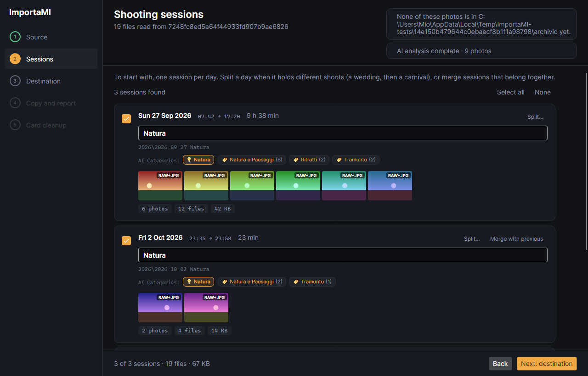
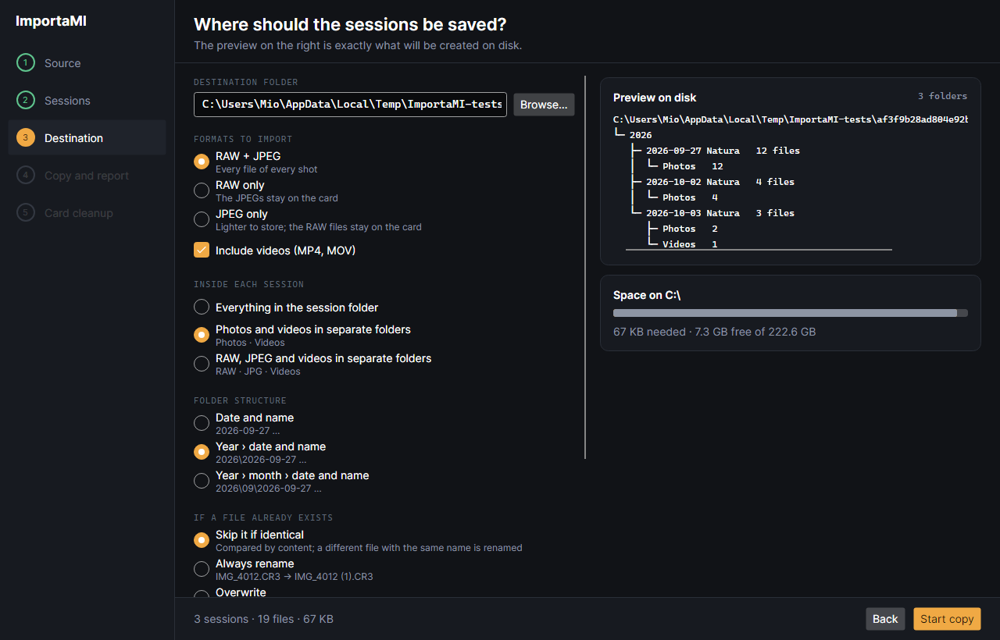
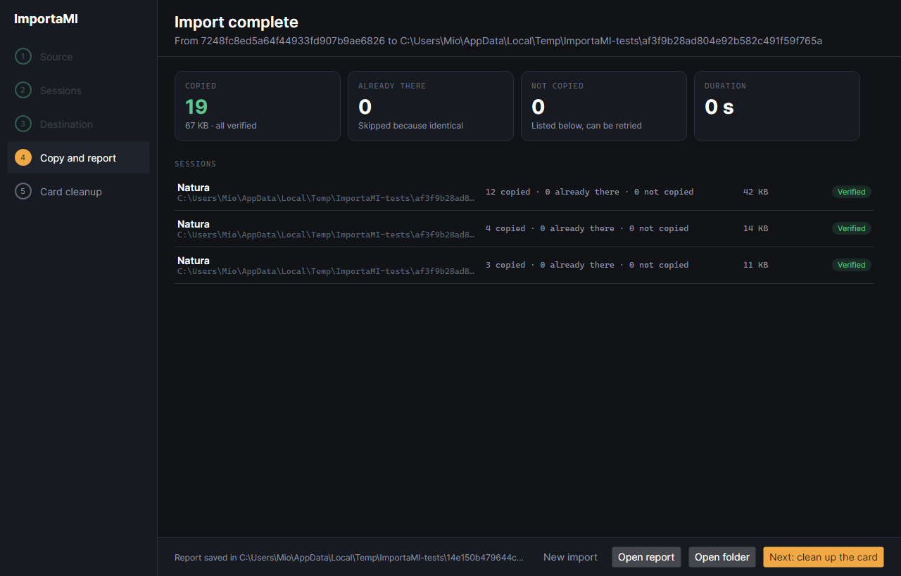

<p align="center">
  
</p>

<h1 align="center">ImportaMI</h1>

<p align="center">
  <b>From the memory card to a tidy archive, one shooting session per folder.</b><br>
  A desktop app by <a href="https://github.com/Mistere-Tech">Mistere Tech</a>
</p>

<p align="center">
  <a href="https://github.com/Mistere-Tech/ImportaMI/releases/latest"></a>
  
  
  
  
</p>

<p align="center"><b>English</b> · <a href="README.it.md">Italiano</a></p>

ImportaMI copies photos and videos from an SD card or external drive to your computer and files them
into one folder per **shooting session**: a wedding, a carnival, a concert.
An image-recognition model running on your computer looks at the photos and suggests a name for each folder.
It runs on Windows, macOS and Linux. The name is Italian for "import me".

> **Status: version 1.0, in testing.** The whole flow works: scan, sessions, AI folder names, destination, verified copy,
> report and card cleanup. It has been tested on Windows; see [Status](#status) for what still needs trying.

<p align="center">
  
</p>

## Download and install

Get the installer for your system from the [latest release](https://github.com/Mistere-Tech/ImportaMI/releases/latest).
It contains everything the app needs, including the AI model: you do not have to install .NET.

| System | File | How to install |
|---|---|---|
| Windows 10 / 11 (64-bit) | `ImportaMI-win-Setup.exe` | Run it. It installs for your user only, with no administrator rights, and adds ImportaMI to the Start menu |
| macOS (Apple silicon) | `ImportaMI-osx-Setup.pkg` | Open it and follow the installer |
| Linux (x64) | `ImportaMI.AppImage` | Make it executable with `chmod +x ImportaMI.AppImage`, then start it |

The installers are not signed yet, so the system may warn you the first time:

- **Windows**: if SmartScreen says "Windows protected your PC", click **More info** and then **Run anyway**.
- **macOS**: if the package "cannot be opened", right-click it, choose **Open**, then confirm.
  If that is not enough, go to **System Settings › Privacy & Security** and click **Open Anyway**.

To uninstall on Windows, use **Settings › Apps**. Your photos are never touched; the settings and reports
stay in the data folder described in [Where ImportaMI keeps its data](#where-importami-keeps-its-data).

## Quick start

1. Plug in the card, or a drive with photos. It appears in **Source** as soon as you connect it; click it.
   You can also use **Choose a folder…** for photos already on your computer.
2. In **Sessions** you get one session per day. While the AI looks at the photos you can split a day
   into several shoots, merge a session with the previous one, and name each one (or click a suggested name).
3. In **Destination** choose the archive folder, the formats and the folder layout.
   The preview on the right is exactly what will be created on disk.
4. **Start copy**. Every file is verified; at the end you get a report.
5. If you like, **clean up the card**: only files that are safely on your computer are deleted.

> For a first try, copy a few photos into a test folder and use **Choose a folder…** as the source:
> the cleanup step really deletes files from the source.

## What it does

You plug in a card, and instead of a flat `DCIM\100EOSR6` folder with 1,200 files you get this:

```text
D:\Photos
└─ 2026
   ├─ 2026-09-27 Bianchi wedding
   │  ├─ Photos   296 files
   │  └─ Videos     4 files
   ├─ 2026-09-27 Carnival parade
   │  └─ Photos   188 files
   └─ 2026-10-02 Concert
      ├─ Photos   340 files
      └─ Videos     6 files
```


The five steps of the app:

1. **Source**: cards and external drives appear as soon as you connect them, or choose any folder.
2. **Sessions**: review the sessions, split or merge them, give each a name, see which photos you already have.
3. **Destination**: where to save, which formats, how to organize the folders.
4. **Copy and report**: verified copy with progress, then a report you can also open as CSV.
5. **Card cleanup**: optional, deletes from the card only what is safely on your computer.

## How photos are catalogued

### 1. The capture time comes from EXIF

Each file is dated with the **EXIF capture time** (`DateTimeOriginal`) written by the camera at the moment of the shot.
File dates are not used, because they change when files are copied or edited.
Videos use the creation time stored in the MP4 or MOV header.
Only when a file has no readable capture time does ImportaMI fall back to the file date, and it tells you which files.

The time is taken exactly as the camera recorded it, without time zones: the dates in the folder names follow the camera clock.

### 2. Files from the same click become one shot

A camera set to RAW + JPEG writes two files per picture. Files in the **same folder with the same name**
(ignoring the extension and letter case) are treated as one shot:

| On the card | Shot |
|---|---|
| `IMG_4012.CR3` + `IMG_4012.JPG` | 1 shot, RAW and JPEG |
| `IMG_4013.CR3` | 1 shot, RAW only |
| `MVI_4501.MP4` | 1 shot, video (videos are never paired with photos) |

Supported files: RAW (CR2, CR3, NEF, NRW, ARW, RAF, ORF, RW2, PEF, SRW, DNG and more), developed images
(JPEG, HEIF/HEIC, PNG, WebP, TIFF; in the format choices they count as "JPEG"), and video (MP4, MOV, MTS, M2TS, AVI).

### 3. Sessions: one per day, then you decide

Time alone cannot tell a wedding from a carnival shot the same afternoon, so ImportaMI does not guess.
It starts with **one session per day** and lets you shape them:

- **Split…** shows every photo of the session. Click the photo where the next shoot starts
  (you can choose several), then confirm.
- **Merge with previous** joins a session to the one before, for example a concert that went past midnight.
- Each session keeps the name you gave it while you split and merge, as long as it still starts with the same photo.

Example:

| Photos on the card | Proposed | After your changes |
|---|---|---|
| Sun 27 Sep, 10:30 → 12:05, wedding | 1 session for the 27th | **Bianchi wedding** |
| Sun 27 Sep, 15:30 → 15:31, carnival | (same session) | split here → **Carnival parade** |
| Fri 2 Oct, 23:35 → 23:58, concert | 1 session for the 2nd | **Concert** |
| Sat 3 Oct, 00:20, end of the concert | 1 session for the 3rd | merged with the previous one |

### 4. The AI suggests what is in the photos

As soon as the sessions appear, ImportaMI looks at every photo **on your computer**, with no internet connection
and without sending anything anywhere. It uses [Places365](http://places2.csail.mit.edu/), a scene-recognition
model (ResNet18, ONNX format) that knows 365 kinds of places. Its answers are grouped into 16 photography categories,
and a few visual checks (colours, capture time) help with the ones the model does not see well, such as sunsets:

> Wedding · Party and birthday · Concert · Sea and beach · Mountain · Nature and landscapes · City and architecture ·
> Sunset · Portraits · Sport · Animals · Night · Snow and winter · Food and restaurants · Cars and motorsport · Macro

The model reads the small preview stored inside each JPEG or RAW file, so the analysis is fast even on large cards.

For each session you see:

- the **main categories** with how many photos belong to each, such as `Natura e Paesaggi (6)` and `Tramonto (2)`;
- a **suggested folder name**, also combining two categories when they go together
  (`Mare al tramonto`, beach at sunset; `Gara motori`, car race; `Città di notte`, city at night);
- **Category not determinable** when no category is clear enough: better no name than a wrong one.

The suggestion fills in the name only if you have not written one yourself; clicking a category uses it as the name.
The **Next** button waits until all the photos have been analysed.
For now the category names and the suggested names are in Italian, in both languages of the interface.

You can use your own ONNX model with the same input and output by placing it at `models/resnet18_places365.onnx`
in the [data folder](#where-importami-keeps-its-data); without a model, ImportaMI falls back to the visual checks alone.

### 5. Each session gets a folder name

The name is always yours: the AI only suggests it, and you can change it before copying.

- The folder name is `date + name`, such as `2026-09-27 Bianchi wedding`.
- Without a name, the folder uses the date alone, such as `2026-09-27`.
- Characters not allowed in folder names on Windows, macOS or Linux (`\ / : * ? " < > |`) are replaced with `_`,
  and trailing spaces and dots are removed, so the same folders work on every system.
- Two selected sessions with the same folder name are flagged: their files would be merged.

You choose how the folders are nested:

| Layout | Example |
|---|---|
| Date and name | `2026-09-27 Bianchi wedding` |
| Year › date and name | `2026\2026-09-27 Bianchi wedding` |
| Year › month › date and name | `2026\09\2026-09-27 Bianchi wedding` |

Inside each session folder you choose how to split the files:

| Option | Inside `2026-10-02 Concert` |
|---|---|
| Everything together | all files |
| Photos and videos separate | `Photos\` and `Videos\` |
| RAW, JPEG and videos separate | `RAW\`, `JPG\` and `Videos\` |

Subfolder names follow the interface language (`Foto` and `Video` in Italian).

<p align="center">
  
</p>

### 6. Photos you already have are recognized

Right after the scan, ImportaMI looks for the card's photos in your archive (the destination folder),
**in any subfolder**, even if they were renamed or you named the session differently last time.

The comparison is on the **content**, never on name or date:

1. the candidates are the archive files with exactly the same size in bytes;
2. a candidate counts as a copy only if the **xxHash64 fingerprint of the whole file** is identical;
3. during the copy the whole file is compared once more before it is skipped.

So two different photos with the same name are never confused, and the same photo renamed in the archive is recognized.
A photo that was edited, resized or re-saved is a different file and is imported again.

A session already imported in full is marked **Already in your archive**, shows where it was found, and is deselected.
A session imported in part shows how many shots are already there; those files are skipped during the copy.
A file with the same name but different content is never treated as a duplicate.

### 7. You choose which formats to copy

| Choice | What is copied | What stays on the card |
|---|---|---|
| RAW + JPEG | every file of every shot | nothing |
| RAW only | the RAW files | the JPEGs |
| JPEG only | the JPEGs | the RAW files; shots with no JPEG are skipped and flagged |

Videos have their own on/off switch.

### 8. Copy and card cleanup are designed to be safe

- Each file is written under a temporary name and renamed only after its **xxHash64 checksum** matches the original,
  so an interrupted copy never leaves half-written files. The original file date is kept.
- A file that already exists at the destination with the same content is skipped; a different file with the same name
  is renamed (`IMG_4012 (1).CR3`), never overwritten, unless you choose to overwrite.
- A file that cannot be read is skipped, listed in the report and can be retried.
- The copy can be paused and canceled. If the card or the destination disappears, or the destination is full, the copy stops and says why.
- A CSV report with the outcome of every file is saved in the app's data folder (see [Where ImportaMI keeps its data](#where-importami-keeps-its-data)).
- **Card cleanup** is a separate step after the report, and only runs after you confirm it. It deletes only files that were copied
  and verified (or found identical in the archive), and just before deleting each one it checks the hash of the copy on your computer again.
  Files protected in the camera, files changed after the copy, formats you did not import, sessions you did not select
  and the camera's own system folders stay on the card.
- At the end the card can be ejected. Choosing **New import** goes back to step 1 with the same card selected
  and tells you how many files are still on it.

Your choices (destination, formats, layout, subfolders, options) are remembered for the next time.

<p align="center">
  
</p>

## Where ImportaMI keeps its data

The destination folder only ever receives your photos and videos. Settings, reports and logs live in the
user's local data folder, in an `ImportaMI` folder:

| System | Folder |
|---|---|
| Windows | `%LOCALAPPDATA%\ImportaMI` |
| macOS | `~/Library/Application Support/ImportaMI` |
| Linux | `~/.local/share/ImportaMI` |

| Inside | Contents |
|---|---|
| `settings.json` | Your choices for the next import |
| `reports\report-yyyyMMdd-HHmmss.csv` | One per import: every file with its outcome, destination and xxHash64 checksum |
| `logs\importami-yyyyMMdd.log` | One per day: scans, archive checks, copies, cleanups, ejects and errors. Kept for 30 days |
| `models\resnet18_places365.onnx` | Optional: your own AI model, used instead of the one included in the app |

A per-user folder is used instead of ProgramData because it exists and is writable on all three systems,
and it keeps each user's history separate on a shared computer.

## When something is not right

A real card is rarely perfect. Nothing below stops the scan: problems are listed under the sessions, file by file.

| Situation | What ImportaMI does |
|---|---|
| USB stick with no photos or videos | Says so, and tells how many other files (documents, music…) it found |
| Empty card or drive | Says it is empty |
| Card disconnected during the scan, copy or cleanup | Stops and says so; what was already done stays valid |
| Destination full or disconnected during the copy | Stops; after fixing it, **Retry** copies only what is missing |
| Destination on the card itself | Refused, with an explanation |
| Not enough space at the destination | The copy cannot start; the needed and free space are shown |
| Photo without a capture time, or with damaged metadata | Uses the file date, marks the session and lists the file |
| RAW the metadata library cannot read, next to a JPEG with the same name | Uses the JPEG's time, without warnings |
| Empty file (0 bytes), typical of an interrupted write | Skips it and lists it |
| Folder or file that cannot be opened | Skips it and lists it |
| macOS `._IMG_0001.JPG` files on FAT and exFAT cards | Ignores them: they look like photos but only hold Finder data |
| Recycle bins and system folders (`$RECYCLE.BIN`, `.Trashes`, `System Volume Information`…) | Does not look inside them |
| Symbolic links and junctions | Does not follow them, to avoid loops |
| Network drives | Not offered as sources: a disconnected one would freeze the list |

## Languages

The interface is available in **English** and **Italian**. It follows the operating system language,
and falls back to English for other languages. To force one, start the app with `--lang=en` or `--lang=it`.

To add a language, create `src/ImportaMI.App/Resources/Strings.<code>.resx`, then add the code to
`LanguageSelection.Supported` and to `SatelliteResourceLanguages` in the app project.
A test fails if a translation is missing a text or has an extra one.

## Status

| Area | State |
|---|---|
| Scanning, capture times, RAW + JPEG pairing | Done, tested |
| Sessions per day, split and merge by clicking photos | Done, tested |
| Duplicates in the archive | Done, tested |
| Destination, formats, folder layouts and subfolders | Done, tested |
| Verified copy, pause, cancel, retry, CSV report | Done, tested |
| Card cleanup and eject | Done, tested (eject tried only on Windows) |
| English and Italian interface | Done, tested |
| Windows | Tested |
| macOS and Linux | Built for them, still to be tried on real machines |
| Capture time of Canon CR3 files without a JPEG twin | To be checked with real cards |
| Thumbnails | From JPEG, PNG and WebP, and from the preview inside TIFF-based RAW (NEF, ARW, CR2, DNG); CR3, HEIC, TIFF and videos show a placeholder |
| AI categories and suggested folder names (Places365) | Done, tested |
| Installers for Windows, macOS and Linux | Done; the Windows one tested |
| Category names in English | Still to do: they are in Italian for now |
| Automatic split of a day by content (a wedding, then a carnival) | Idea for a later version, building on the AI categories |

The flow is also shown in the [interactive prototype](docs/ui-prototype.html): download it and open it in a browser.

## Built with

- .NET 10 (LTS) and C#
- [Avalonia UI](https://avaloniaui.net/) 12 with the Fluent theme
- CommunityToolkit.Mvvm
- [MetadataExtractor](https://github.com/drewnoakes/metadata-extractor-dotnet) for EXIF and video metadata
- System.IO.Hashing (xxHash64) for verification
- [ONNX Runtime](https://onnxruntime.ai/) and SkiaSharp for the on-device AI,
  with the [Places365](https://github.com/CSAILVision/places365) ResNet18 model by MIT CSAIL
- [Velopack](https://velopack.io/) for the installers
- xUnit, and Avalonia Headless for the interface tests

## Project layout

| Project | Contents |
|---|---|
| `src/ImportaMI.Core` | Scanning, sessions, AI classification, archive check, copy, cleanup and settings, with no dependency on the user interface |
| `src/ImportaMI.App` | The Avalonia desktop app (MVVM) and its translations |
| `tests/ImportaMI.Core.Tests` | Tests on real files in temporary folders: scanning, copy, duplicates, cleanup, translations |
| `tests/ImportaMI.App.Tests` | The real app run without a window on a simulated card, in both languages, through the whole flow, saving a screenshot of each screen |
| `build/package.ps1` | Creates the installer for the system it runs on |
| `docs/brand` | ImportaMI and Mistere Tech icons and logos |

## Build and run from source

Requires the [.NET 10 SDK](https://dotnet.microsoft.com/download) and Git.

```bash
git clone https://github.com/Mistere-Tech/ImportaMI.git
cd ImportaMI
dotnet build ImportaMI.slnx
dotnet test
dotnet run --project src/ImportaMI.App
dotnet run --project src/ImportaMI.App -- --lang=it
```

ImportaMI really copies files, and the cleanup step really deletes them from the card. For a first try,
copy a few photos into a folder and use **Choose a folder…** as the source.
`dotnet test` saves screenshots of every screen in `tests/ImportaMI.App.Tests/bin/Debug/net10.0/screenshots`.

## Create the installers

`build/package.ps1` (PowerShell 7) publishes the app self-contained and packages it with Velopack.
The result goes in `artifacts/releases/<runtime>`.

```bash
pwsh ./build/package.ps1
pwsh ./build/package.ps1 -Runtime osx-arm64 -Version 1.0.2
```

Each installer has to be built on its own system. To get all three, use the **Installer** GitHub Action:
run it by hand from the Actions tab, or push a version tag to also publish a release with the installers attached.

```bash
git tag v1.0.2
git push origin v1.0.2
```

---

<p align="center">
  <br>
  Made with care in Ascoli Piceno, Italy, by <a href="https://github.com/Mistere-Tech">Mistere Tech</a>
</p>
